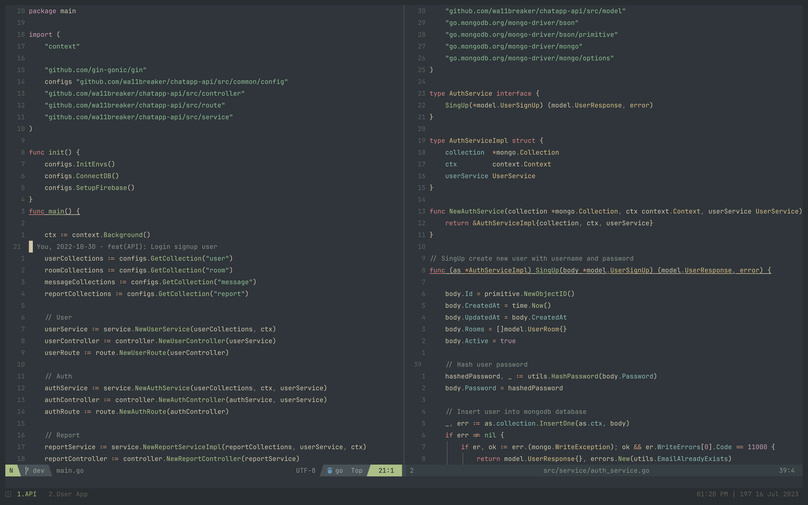

# dotfiles

Zsh, Kitty, Neovim, Tmux



Managed with [GNU Stow](https://www.gnu.org/software/stow/): each top-level folder
(`kitty`, `nvim`, `tmux`) mirrors `$HOME` and is symlinked into place.

## Setup

```sh
brew install stow
git clone https://github.com/wa11breaker/dotfiles.git ~/dotfiles
~/dotfiles/setup.sh        # dry run, asks to confirm, then: stow -R kitty nvim tmux
```

To pick up changes later: `cd ~/dotfiles && git pull && stow -R kitty nvim tmux`.

## Shell tools

```sh
brew install zoxide tmux bat

# FZF
git clone --depth 1 https://github.com/junegunn/fzf.git ~/.fzf
~/.fzf/install
```

## Font

Kitty uses Terminess Nerd Font Mono (Nerd Font glyphs are also needed for
Neovim's diagnostic signs).

```sh
brew install --cask font-terminess-ttf-nerd-font
```

## Neovim

Requires **Neovim 0.12+**. Plugins are managed by the built-in `vim.pack`
(pinned in `nvim-pack-lock.json`) and install automatically on first launch.

### Dependencies

```sh
brew install neovim ripgrep fd tree-sitter-cli node imagemagick
```

| Tool | Used by |
|---|---|
| `ripgrep`, `fd` | fzf-lua (live grep, file search) |
| `tree-sitter-cli` | nvim-treesitter (`main` branch compiles parsers) |
| `node` | Mason LSP servers (ts_ls, pyright, jsonls, ...) |
| `imagemagick` | snacks.nvim images (converts JPG/GIF/WebP/... for kitty) |

### Images

Images render in Kitty via the kitty graphics protocol (snacks.nvim `image`):
opening an image file, fzf-lua previews, oil preview (`<C-p>`), and a preview
float beside nvim-tree when the cursor is on an image. Inside tmux this needs
`allow-passthrough on` (already set in `tmux.conf`). Check with
`:checkhealth snacks`.

LSP servers are installed through Mason (`:Mason`); every installed server is
enabled automatically. `lua_ls` and `jsonls` are installed on first launch.

Formatters (format on save via conform.nvim; install the ones you need):

```sh
brew install stylua          # Lua
pipx install black isort     # Python
npm install -g prettier      # JavaScript / TypeScript
```

Dart formatting and the Dart LSP come from the Flutter/Dart SDK (below).

### Optional: flutter-bloc.nvim

`init.lua` loads a local checkout of flutter-bloc.nvim if it exists at
`~/development/projects/neovim/flutter-bloc.nvim`; it is skipped otherwise.

## Flutter

Flutter is installed through [FVM](https://fvm.app). Neovim finds the SDK on
its own (project `.fvm/flutter_sdk`, then `PATH`, then `~/fvm/default`).

```sh
brew tap leoafarias/fvm && brew install fvm
fvm install stable && fvm global stable
```

Add to `~/.zprofile`:

```sh
export PATH="$HOME/fvm/bin:$HOME/fvm/default/bin:$PATH"
```

### Android (without Android Studio)

```sh
brew install openjdk@17
brew install --cask android-commandlinetools
```

Add to `~/.zprofile`:

```sh
export JAVA_HOME="/opt/homebrew/opt/openjdk@17"
export ANDROID_HOME="/opt/homebrew/share/android-commandlinetools"
export PATH="$JAVA_HOME/bin:$ANDROID_HOME/cmdline-tools/latest/bin:$ANDROID_HOME/platform-tools:$ANDROID_HOME/emulator:$PATH"
```

Install the SDK and create an emulator:

```sh
yes | sdkmanager --licenses
sdkmanager "platform-tools" "emulator" "platforms;android-36" "build-tools;37.0.0" \
           "system-images;android-36;google_apis;arm64-v8a"
avdmanager create avd -n pixel -k "system-images;android-36;google_apis;arm64-v8a" -d pixel_7

flutter config --android-sdk "$ANDROID_HOME" --jdk-dir "$JAVA_HOME"
flutter doctor
```

Recommended in `~/.android/avd/pixel.avd/config.ini`:

```ini
hw.ramSize=4G
vm.heapSize=512M
hw.gpu.enabled=yes
hw.gpu.mode=host
```

Start it with `emulator -avd pixel`.

**Breakpoints and "app isn't responding":** Flutter runs Dart on Android's main
thread, so pausing at a breakpoint for more than 5s triggers an ANR dialog.
Raise Android's timeouts (resets on every emulator boot):

```sh
adb root && adb shell setprop ro.hw_timeout_multiplier 12 && adb shell stop && adb shell start
```

## Debugging Flutter in Neovim

Two DAP configurations (nvim-dap + `flutter debug_adapter`):

- **Launch (pick device):** builds and runs the app from Neovim.
- **Attach to running app:** attaches to an app started with `flutter run` in a
  terminal (keeps hot reload there). On Android the VM service URL is found
  automatically. Web (Chrome) apps can't be attached to; use Launch.

| Key | Action |
|---|---|
| `<Space>dc` | Start / continue |
| `<Space>db` / `<Space>dB` | Toggle breakpoint / conditional breakpoint |
| `<Space>dn` / `di` / `do` | Step over / into / out |
| `<Space>dr` | Run to cursor |
| `<Space>de` | Evaluate under cursor |
| `<Space>dv` | Toggle DAP view |
| `<Space>dR` / `<Space>dq` | Restart / disconnect |

While a session is active, `n` / `i` / `o` / `c` also step over / into / out /
continue; they revert when the session ends.
